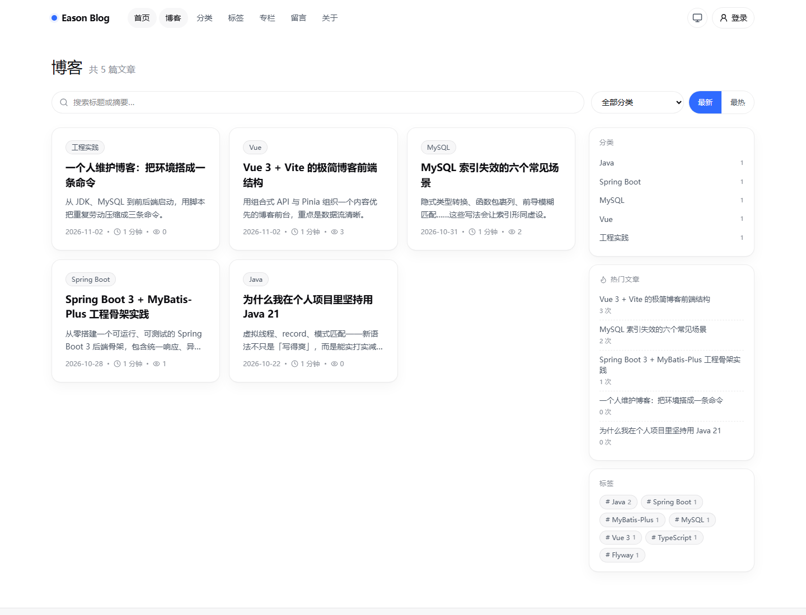

# Eason Blog 前台 Bug 与功能缺失审计报告

| 项 | 内容 |
| --- | --- |
| 报告日期 | 2026-11-03 |
| 审计对象 | 前台 `http://localhost:5173`；接口 `http://127.0.0.1:8080` |
| 代码版本 | `7288ed6`（P5 + P6） |
| 审计范围 | `blog-frontend` 全部源码；`blog-server` 与前台相关的公开接口、认证、互动、内容读取逻辑；后台仅抽查与前台数据一致性相关的部分 |
| 审计方式 | 源码走查 + 接口实测 + 现有截图核对 + `vue-tsc` 类型检查 |
| 总体结论 | 站点可正常访问，构建与类型检查通过；但存在 **2 个阻断级功能问题**、**10 个明显缺陷**、**8 个一般问题**，以及若干影响博客完整度的功能缺失 |

---

## 1. 执行摘要

### 1.1 问题分布

| 级别 | 数量 | 说明 |
| --- | --- | --- |
| P0 阻断 | 2 | 个人中心完全不可达；专栏详情无法通过站内导航打开 |
| P1 严重 | 10 | 导航状态、SEO 元信息、文章被互动请求拖垮、评论树、搜索入口、分页截断、通知链接、分类页、列表标签、收藏越权数据 |
| P2 一般 | 8 | favicon、封面/头像、改密失效、后台标签创建、专栏绑定、后台状态、生产入口、限流 IP |
| 功能缺失 | 18 项（归为 8 类） | 留言回复、评论分页、归档、RSS/SEO 基础设施、上下篇/分享/代码复制、找回密码/邮箱验证、通知角标与分页、封面/头像 |

### 1.2 最需要先处理的五件事

1. **修复 `/user` 路由守卫**：当前 `HttpOnly` Cookie 被前端当成可读 Cookie 判断，登录后访问个人中心会被无限弹回登录页。
2. **修复专栏列表 → 详情的组件复用**：`/columns` 与 `/column/:slug` 共用组件且只在 `onMounted` 取数，站内点击专栏卡片不会加载详情。
3. **修复导航高亮**：`首页` 在所有页面都处于 active 状态；详情页对应栏目反而不高亮。
4. **修复文章页 SEO 元信息**：`og:*` 被写成 `metaproperty`，且离开文章页不重置，首页/列表页会沿用上一篇的标题和描述。
5. **把互动请求与文章正文加载解耦**：点赞/评论接口失败时，整篇文章会被错误提示替换。

### 1.3 已确认正常的部分

- `5173` 页面可访问，Vite 代理 `/api` 正常转发到 `8080`。
- `vue-tsc --noEmit` 退出码 0，无类型错误。
- 后端公开接口（文章、分类、标签、专栏、搜索、站点配置、留言）返回结构与前端类型基本一致。
- 文章正文使用 `marked + DOMPurify`，先净化再 `v-html`，未发现直接把 Markdown 原始 HTML 注入 DOM 的路径。
- 认证 Cookie 使用 `HttpOnly + SameSite=Lax`，前端不持有 token，XSS 窃取凭证的风险较低。
- 文章详情、分类/标签分页、点赞/收藏等主要链路在接口层可用。

---

## 2. 审计方法与限制

### 2.1 已执行

- 阅读 `blog-frontend/src` 下全部页面、组件、路由、Store、API 封装。
- 阅读 `blog-server` 中与前台相关的 Controller、Service、VO、Mapper、安全配置。
- 对 `5173` 与 `8080` 发起真实请求，验证登录 Cookie、文章列表/详情、搜索、分类、标签、留言、错误响应。
- 核对 `docs/screenshots` 中已有的首页、博客、文章页截图。
- 执行 `vue-tsc --noEmit` 确认构建类型检查通过。

### 2.2 未执行 / 限制

- 当前 Windows 沙箱阻止 Edge/Chromium 创建命名管道，无法启动无头浏览器做完整点击流回归。
- 因此，**P0-2、P1-2、P1-3、P1-4 等为代码级确认**；P1-1 有仓库截图佐证；其余接口类问题为实测确认。
- 未修改任何业务数据；仅进行了登录、只读查询，以及一次针对不存在文章 ID 的无效 PATCH（返回 400，未产生数据变更）。
- 未做压力测试、完整安全渗透、后台全页面走查。

---

## 3. 问题详情

### P0-1 个人中心永远打不开，登录后被弹回登录页

| 项 | 内容 |
| --- | --- |
| 级别 | P0 阻断 |
| 位置 | `blog-frontend/src/router/index.ts:43-48`；`blog-server/.../auth/controller/AuthController.java:88-97` |
| 置信度 | 高（代码 + 实测 Cookie 头） |

**现象**

用户登录成功后，页头显示昵称与用户菜单；点击「个人中心」或直接访问 `/user`，会被重定向回 `/login?redirect=/user`。再次登录仍重复该过程。

**根因**

路由守卫使用：

```ts
const tokenExisted = document.cookie.includes('blog_token=')
if (to.meta.requiresAuth && !tokenExisted) {
  return { name: 'login', query: { redirect: to.fullPath } }
}
```

但登录接口下发的 Cookie 明确带有 `HttpOnly`：

```text
Set-Cookie: blog_token=...; Path=/; Max-Age=7200; HttpOnly; SameSite=Lax
```

`HttpOnly` 的设计目标就是让 JavaScript 无法读取，因此 `document.cookie` 永远不包含 `blog_token=`，守卫永远判定未登录。

**影响**

- 个人资料、修改密码、我的收藏、通知中心全部不可达。
- 登录后访问 `/user` 会形成“登录页 ↔ 个人中心”的重定向循环。
- 页头状态与页面状态矛盾，用户会认为登录失败。

**修复建议**

- 守卫改为异步读取用户态，例如 `await userStore.fetchMe()`，再决定是否跳转；后台的 `router/index.ts:110-118` 已是正确写法。
- 或移除 Cookie 判断，直接放行 `/user`，由页面请求 `/auth/me` 的 401 兜底并跳转登录。
- 不要为了前端判断把 token 改成非 `HttpOnly`，那会重新引入 XSS 窃取风险。

**复现步骤**

1. 打开 `http://localhost:5173/login`，登录。
2. 点击右上角用户菜单 →「个人中心」。
3. 观察 URL 变为 `/login?redirect=/user`，页面回到登录表单。

---

### P0-2 专栏列表点击进入详情不刷新

| 项 | 内容 |
| --- | --- |
| 级别 | P0 阻断 |
| 位置 | `blog-frontend/src/router/index.ts:23-24`；`blog-frontend/src/views/ColumnsView.vue:16-33` |
| 置信度 | 高（Vue Router 组件复用规则）；建议实机点击复核 |

**现象**

在 `/columns` 专栏列表点击任意专栏卡片，URL 变为 `/column/xxx`，但页面仍显示专栏列表，标题、返回链接、文章列表都不更新。直接手输 `/column/xxx` 或刷新页面则正常。

**根因**

```ts
{ path: 'columns', component: () => import('@/views/ColumnsView.vue') },
{ path: 'column/:slug', component: () => import('@/views/ColumnsView.vue') },
```

两个路由复用同一个组件，组件只在 `onMounted` 中根据 `route.params.slug` 取数：

```ts
onMounted(async () => {
  const slug = route.params.slug ? String(route.params.slug) : ''
  if (slug) { ... } else { columns.value = await taxonomyApi.columns() }
})
```

Vue Router 在“不同路由复用同一组件”时会复用组件实例，`onMounted` 不会再次执行；组件又没有 `watch` 路由参数，因此站内跳转不会重新加载。

**影响**

- 专栏功能在站内导航下不可用，用户会以为点击没反应。
- 从专栏详情点「全部专栏」返回时，页面会停留在详情状态。
- 直接分享/刷新链接反而正常，问题不易被自动化 smoke test 发现。

**修复建议**

- 监听 `route.params.slug`，变化时重新加载；或把列表页/详情页拆成两个组件。
- 或在 `App.vue` 的 `<RouterView>` 上使用 `:key="$route.fullPath"` 强制重建（代价是页面状态全部丢失，需权衡）。

---

### P1-1 导航「首页」在所有页面都高亮

| 项 | 内容 |
| --- | --- |
| 级别 | P1 严重（明显视觉错误） |
| 位置 | `blog-frontend/src/components/SiteHeader.vue:88-97` |
| 置信度 | 高（截图 + Vue Router 规则） |

**现象**

访问 `/blog` 时，「首页」和「博客」同时高亮；访问文章页时只有「首页」高亮；分类/标签/专栏详情页对应栏目不高亮。

**根因**

`RouterLink to="/"` 使用默认 `active-class`。`/` 的子路由 `path: ''`，Vue Router 的 `activeRecordIndex` 对“空 path 子路由”有特殊判定：当链接的末级记录路径等于父记录路径时，会回退到父记录匹配，导致根链接在任意子页面都被判为 active。

此外，文章页没有映射到「博客」，分类/标签/专栏详情页也没有映射到对应栏目，所以这些页面没有正确的高亮项。

**影响**

- 导航层级表达错误，用户无法判断当前所在栏目。
- 截图 `docs/screenshots/blog.png` 可直接看到两个同时高亮的胶囊。

**修复建议**

- 根链接改用 `exact-active-class="link--active"`，去掉普通 `active-class`；或按 `route.name` 计算 class。
- 为 `/article/:slug` 映射「博客」，为 `/category/*`、`/tag/*`、`/column/*` 映射对应栏目。



---

### P1-2 文章页 SEO 元信息写坏且不会复原

| 项 | 内容 |
| --- | --- |
| 级别 | P1 严重 |
| 位置 | `blog-frontend/src/views/ArticleView.vue:97-117` |
| 置信度 | 高（代码级，选择器解析已单独验证） |

**现象**

- 文章页的 `og:title`、`og:description`、`og:type` 不是标准 OpenGraph 标签，社交平台/搜索引擎无法识别。
- 每切换一篇文章，`<head>` 中会多出一批无效 meta。
- 从文章页返回首页/博客后，浏览器标签标题、`description`、`og:*` 仍是上一篇文章的内容。

**根因**

动态创建 meta 的代码：

```ts
let el = document.head.querySelector(selector)
if (!el) {
  el = document.createElement('meta')
  const [key, val] = selector.replace(/[[\]']/g, '').split('=')
  el.setAttribute(key, val)
  document.head.appendChild(el)
}
```

对 `meta[property="og:title"]` 执行后得到的是 `metaproperty=og:title`，于是创建出：

```html
<meta metaproperty="og:title" content="...">
```

这不是合法的 OpenGraph 标签。下一次查询 `meta[property="og:title"]` 仍然找不到（因为属性名错了），于是继续追加，形成重复垃圾标签。

同时，`document.title`、`meta[name="description"]` 只在文章页写入，路由离开时没有重置逻辑。

**影响**

- 微信/X/Twitter 等分享卡片缺少标题、描述、图片。
- 搜索引擎抓取首页/列表页时，可能拿到上一篇（或任意一篇）文章的标题与描述。
- `<head>` 随浏览文章数量增长，属于 DOM 泄漏。

**修复建议**

- 创建标签时使用明确的属性名：
  ```ts
  el.setAttribute('property', 'og:title')
  ```
- 补齐 `og:image`、`og:url`、`canonical`、`article:published_time` 等字段。
- 在 `router.afterEach` 中按路由重置站点级 `title` 与 `description`，文章页再覆盖。
- 若后续需要更好的 SEO，考虑 SSR/预渲染；纯 SPA 的正文对爬虫仍不友好。

---

### P1-3 点赞/评论请求失败会把整篇文章变成错误页

| 项 | 内容 |
| --- | --- |
| 级别 | P1 严重 |
| 位置 | `blog-frontend/src/views/ArticleView.vue:53-78`；模板 `230-233` |
| 置信度 | 高（代码级） |

**现象**

文章正文已经渲染成功后，如果 `GET /articles/{id}/interaction` 或 `GET /articles/{slug}/comments` 返回错误（500、超时、网络抖动），页面会立即切换到错误提示，正文、目录、评论全部消失。

**根因**

详情、互动状态、评论被放在同一个 `try` 中：

```ts
const data = await articleApi.detail(slug)
article.value = data
html.value = ...
loading.value = false
...
interaction.value = await interactionApi.status(data.id)
comments.value = await interactionApi.comments(slug)
} catch (e) {
  error.value = (e as Error).message
}
```

而模板中 `v-if="error"` 的优先级高于 `v-else-if="article"`，所以任一附属请求失败都会让整页进入错误态。

**影响**

- 评论服务异常会连带文章不可读，属于可用性放大。
- 慢请求还会延后评论区出现，用户会以为文章没加载完。

**修复建议**

- 详情单独 `try/catch`；互动/评论各自 `catch` 并降级为空状态。
- 或使用 `Promise.allSettled`，只对详情失败展示错误页。
- 首页的 7 个 `Promise.all` 也建议同样处理（`HomeView.vue:27-51`），避免统计接口失败导致整页空白。

---

### P1-4 三级回复永远不显示，评论数口径不一致

| 项 | 内容 |
| --- | --- |
| 级别 | P1 严重 |
| 位置 | `blog-server/.../InteractionService.java:113-131`；`blog-frontend/src/views/ArticleView.vue:289-310` |
| 置信度 | 高（代码级） |

**现象**

- 对某条“回复”再次回复，提交成功、数据库有记录，但页面只显示到第二层，第三层评论永远看不到。
- 评论区标题显示的数量与文章底部按钮的数量可能不一致。

**根因**

后端 `buildTree` 是无限递归的，`CommentVO.replies` 可以嵌套任意层；但前端模板只渲染：

```vue
<div v-for="comment in comments">
  ...
  <div v-for="reply in comment.replies">
    ...
  </div>
</div>
```

没有递归组件，第二层以下的 `reply.replies` 被忽略。

同时：

- 评论区标题使用 `comments.length`，只统计顶层评论；
- 底部按钮使用 `interaction.commentCount`，统计所有已通过评论。

两者在有回复时必然不同。

**影响**

- 用户会认为“回复失败”或“评论丢失”。
- 评论区数字与文章互动数字对不上，降低可信度。

**修复建议**

- 抽取递归 `CommentItem` 组件，按 `replies` 递归渲染。
- 标题直接用 `interaction.commentCount`，或统一由后端返回 total。
- 若产品上只允许两层，后端应限制 `parentId` 只能是顶层评论，并在 UI 隐藏第二层的“回复”按钮。

---

### P1-5 独立搜索页 `/search` 没有任何入口

| 项 | 内容 |
| --- | --- |
| 级别 | P1 严重（功能不可发现） |
| 位置 | `blog-frontend/src/router/index.ts:25`；`SiteHeader.vue`、`SiteFooter.vue` |
| 置信度 | 高（全量搜索确认无链接） |

**现象**

`/search` 页面存在且能按标题、摘要、正文搜索，但页头、页脚、首页、博客页均没有链接。用户只能手动输入 URL。

**根因**

- 路由注册了 `/search`，但没有导航入口。
- 博客页内的搜索框走的是 `/articles?keyword=`，后端只匹配标题和摘要，不搜正文。
- 两套搜索能力并存，能力更强的 `/search` 被隐藏。

**影响**

- README/开发日志宣称的“站内搜索”在体验上等于不存在。
- 用户搜不到只出现在正文里的关键词。

**修复建议**

- 页头增加搜索图标/按钮，跳转 `/search`；或把博客页搜索框直接改为跳 `/search?q=`。
- 保留 `/articles?keyword=` 作为列表筛选，但文案要写清楚只搜标题/摘要。

---

### P1-6 留言/收藏/通知被截断，且没有未读角标

| 项 | 内容 |
| --- | --- |
| 级别 | P1 严重 |
| 位置 | `GuestbookView.vue:26`；`UserView.vue:37`、`47`；`api/index.ts:76` |
| 置信度 | 高（代码级） |

**现象**

- 留言板固定请求 `page=1&size=20`，没有翻页器；第 21 条留言永远不会出现。
- 我的收藏固定 `page=1&size=20`，不翻页；第 21 个收藏不可见。
- 通知固定 `limit=30`，不翻页；第 31 条通知不可见。
- `GET /users/me/notifications/unread-count` 在 API 层已封装，但 UI 从未调用，页头也没有未读红点。

**根因**

页面只实现了“第一页”的读取，没有接入已有的分页组件/分页参数；未读计数接口只定义未使用。

**影响**

- 数据量增长后表现为“内容丢失”。
- 用户不知道有新通知，通知功能形同虚设。

**修复建议**

- 留言板、收藏、通知统一接入分页；通知可改为“加载更多”。
- 页头用户菜单显示未读数，进入通知页后刷新；支持“全部已读”。

---

### P1-7 通知里的链接会 404

| 项 | 内容 |
| --- | --- |
| 级别 | P1 严重 |
| 位置 | `blog-server/.../InteractionService.java:164-165`；前台路由表 |
| 置信度 | 高（代码级） |

**现象**

管理员在读者端收到“收到新评论”通知，点击后进入 404 页面。

**根因**

通知写入的 `link` 是 `/admin/comments`：

```java
notify(article.getAuthorId(), "COMMENT", "收到新评论",
        nickname + " 评论了《" + article.getTitle() + "》，待审核", "/admin/comments");
```

但 `blog-frontend` 没有 `/admin/*` 路由，`/admin/comments` 会命中 `/:pathMatch(.*)*` 的 NotFound。

**影响**

- 管理员无法从通知直接进入审核页。
- 读者端出现无意义的 404，体验割裂。

**修复建议**

- 通知链接按角色生成：管理员跳后台地址（生产为 `/admin/comments`，开发为 `http://host:5174/comments`），普通用户跳文章/个人中心。
- 或在读者端拦截 `/admin/*`，提示“请前往管理后台”并给出可点击链接。

---

### P1-8 空分类页标题退化成「分类文章」，分页也不写回 URL

| 项 | 内容 |
| --- | --- |
| 级别 | P1 严重（内容较少时更明显） |
| 位置 | `CategoryDetailView.vue:40-41`、`52`；`TagDetailView.vue:64` |
| 置信度 | 高（代码级） |

**现象**

- 新建但还没有文章的分类，点进去标题是「分类文章」，看不到分类名和描述。
- 分类/标签页翻到第 2 页后，刷新或浏览器后退会回到第 1 页，因为页码没有写入 URL。

**根因**

分类页标题取的是第一条文章的 `categoryName`：

```ts
<h1>{{ page?.records[0]?.categoryName || '分类文章' }}</h1>
```

分类下没有文章时 `records` 为空；后端也没有 `GET /categories/{slug}` 详情接口，无法单独取分类名/描述。

分页按钮直接调用 `load(slug, p)`，没有 `router.push` 更新 `?page=`。

**影响**

- 空分类页面信息缺失，用户不知道自己在哪个分类。
- 分享/刷新丢失分页位置，后退行为不符合预期。

**修复建议**

- 后端补 `GET /categories/{slug}`，或前端在加载文章的同时从 `/categories` 列表里查名称与描述。
- 分页改为写回 query，与 `BlogView`、`SearchView` 保持一致。

---

### P1-9 列表接口的 `tags` 永远是空数组

| 项 | 内容 |
| --- | --- |
| 级别 | P1 严重（数据契约错误） |
| 位置 | `ArticleServiceImpl.java:162-179`；`SearchService.java:58-73`；`ColumnService.java:78-88`；`InteractionService.java:448-460` |
| 置信度 | 高（接口实测） |

**现象**

- `GET /api/v1/articles` 返回的每条文章都是 `"tags":[]`。
- `GET /api/v1/articles/{slug}` 同一篇文章却返回 `"tags":["Flyway"]`。
- 搜索结果、专栏文章、收藏列表同样丢失标签。

**根因**

多个列表转换方法把标签写死为空列表：

```java
List.of(),   // ArticleServiceImpl.toSummary
List.of(),   // SearchService
List.of(),   // ColumnService
List.of(),   // InteractionService.toSummary
```

只有详情接口 `detail()` 会查 `articleTagMapper.selectTagsByArticleId`。

**影响**

- 前端类型声明 `tags: string[]` 与实际数据不符。
- 以后在卡片、搜索结果、收藏列表展示标签会直接缺数据。
- 专栏文章还额外丢失了 `categoryName`（`ColumnService` 传了 `null`），摘要也没有走“正文截取”回退。

**修复建议**

- 列表查询批量取标签（一次 `IN` 查询按文章分组），避免 N+1。
- 或前端明确不需要列表标签，则从 VO/类型中移除该字段，避免误导。

---

### P1-10 收藏列表可能暴露已下线/私密文章

| 项 | 内容 |
| --- | --- |
| 级别 | P1 严重（隐私/权限边界） |
| 位置 | `InteractionService.java:245-263` |
| 置信度 | 高（代码级） |

**现象**

文章被作者改为私密（`visibility=1`）或下线（`status=2`）后，曾经收藏过它的用户仍能在“我的收藏”里看到标题和摘要；点进去才 404。

**根因**

收藏列表只按 ID 批量取文章：

```java
Map<Long, Article> articles = articleMapper.selectBatchIds(ids)...
```

`selectBatchIds` 只会应用逻辑删除过滤，不会过滤 `status` / `visibility`。

**影响**

- 私密文章的标题、摘要泄露给收藏者。
- 收藏总数与实际可读列表不一致，可能出现空白页。
- 用户点击后得到 404，体验差。

**修复建议**

- 查询时追加 `status=1 AND visibility=0`；对不可读文章返回“已下线”占位或直接跳过，并同步修正 total。
- 收藏计数也应只统计公开文章。

---

### P2-1 favicon 缺失

| 项 | 内容 |
| --- | --- |
| 位置 | `blog-frontend/index.html:3` |
| 置信度 | 高（实测 + 构建产物核对） |

`index.html` 引用 `/favicon.svg`，但 `blog-frontend` 没有 `public` 目录，`dist` 中也没有 `favicon.svg`。

- 开发环境：Vite SPA fallback 返回 `index.html`（200 `text/html`），浏览器拿到 HTML 当图标。
- 生产环境：Nginx 对 `.svg` 使用 `try_files $uri =404`，直接 404。

**建议**：在 `blog-frontend/public/favicon.svg` 放置图标，构建后会复制到 `dist`。

---

### P2-2 封面图与头像全站未渲染

| 项 | 内容 |
| --- | --- |
| 位置 | `ArticleCard.vue`、`ArticleView.vue`、`ArticleView.vue` 评论区、`SiteHeader.vue` |
| 置信度 | 高（模板中无引用） |

`cover` 字段在数据库、后端 VO、后台编辑页都存在；`avatar` 字段在 `UserVO`、`CommentVO` 中存在。但前台模板没有任何 `` 使用它们。

**影响**

- 后台设置的封面不会出现在首页/列表/详情。
- 评论区和页头永远只有昵称，用户资料里的头像没有展示。

**建议**：要么补展示（卡片封面、详情头图、评论头像），要么从后台表单/类型中移除，避免“配置了但没效果”。

---

### P2-3 修改密码后旧登录态仍有效

| 项 | 内容 |
| --- | --- |
| 位置 | `UserServiceImpl.java:74-88`；`UserView.vue:87-101` |
| 置信度 | 高（代码级） |

修改密码只更新 `password` 字段，JWT 是无状态的，没有 token 版本号或 `passwordChangedAt` 校验。旧 Cookie 在过期前（默认 120 分钟）仍然可以访问。

前端提示“密码已修改，请重新登录”，但没有调用 `logout()`，用户也不会被强制退出。

**建议**

- 在用户表增加 `token_version` 或 `password_changed_at`，签发/校验 JWT 时比对。
- 改密成功后前端立即 `logout()` 并跳转登录页。
- 提供“退出所有设备”能力。

---

### P2-4 后台标签「allow-create」会报 400

| 项 | 内容 |
| --- | --- |
| 位置 | `blog-admin/src/views/ArticleEditView.vue:181-193`；`ArticleUpsertRequest.java:47` |
| 置信度 | 高（接口实测） |

编辑器允许在标签下拉框里直接输入新标签（`allow-create`），Element Plus 会把输入内容作为字符串放入 `form.tagIds`。后端字段是 `List<Long>`，Jackson 无法把字符串反序列化为 `Long`。

实测：

```text
PATCH /api/v1/admin/articles/999999
{ "title": "x", "content": "y", "tagIds": ["new-tag"], "status": 0 }
→ 400 {"code":400,"message":"请求体格式不正确"}
```

**建议**：要么去掉 `allow-create`，要么在提交前先调用创建标签接口拿到 ID；也可以让后端接受 `tagNames` 并对新标签做 upsert。

---

### P2-5 后台没有「专栏-文章」绑定/排序 UI，编辑专栏会丢排序

| 项 | 内容 |
| --- | --- |
| 位置 | `blog-admin/src/views/ColumnsView.vue:88-95`、`33-42`；`ColumnVO.java` |
| 置信度 | 高（代码级） |

- 专栏管理只有专栏本身的增删改，没有把文章加入专栏、调整专栏内顺序的界面；`blog_column_article` 目前只能靠演示数据或手工 SQL 维护。
- 编辑专栏时 `openEdit` 把 `sort` 固定写成 `0`，`ColumnVO` 也不返回 `sort`，保存一次就会把原有排序重置为 0。

**建议**：补专栏文章管理（选择文章、拖拽排序），并让 `ColumnVO` 返回 `sort`，编辑时回填。

---

### P2-6 后台新建文章后状态显示错误，「保存草稿」对已发布文章无效

| 项 | 内容 |
| --- | --- |
| 位置 | `blog-admin/src/views/ArticleEditView.vue:84-88`、`125-134`；`AdminArticleService.java:152-166` |
| 置信度 | 高（代码级） |

- `/articles/create` 与 `/articles/:id/edit` 共用 `ArticleEditView`；创建成功后 `router.replace` 复用组件实例，`onMounted` 不再执行，`status` 仍是 0。文章其实已经发布，页面却显示「草稿」。
- `AdminArticleService.update()` 完全不读取 `request.status()`，所以编辑已发布文章时点「保存草稿」只会保存内容，不会下架；UI 的按钮语义与后端行为不一致。

**建议**：`update` 明确处理 `status` 的状态迁移（或干脆从请求中移除 status，避免误解）；创建成功后主动 `load()` 或使用 `:key` 强制重建编辑页。

---

### P2-7 生产环境「写文章」链接会打不开

| 项 | 内容 |
| --- | --- |
| 位置 | `blog-frontend/src/components/SiteHeader.vue:30-32`；`deploy/nginx/eason-blog.conf:54-59` |
| 置信度 | 高（代码 + 部署配置） |

页头固定拼接：

```ts
`${window.location.protocol}//${window.location.hostname}:5174`
```

但生产 Nginx 把后台部署在 `https://域名/admin/`，并没有暴露 5174 端口。线上点「写文章」会连接失败。

**建议**：通过环境变量配置后台地址（如 `VITE_ADMIN_URL`），生产设为 `/admin/`，开发设为 `http://host:5174`；或按当前 host 是否为 localhost 做分支。

---

### P2-8 限流/IP 可被 `X-Forwarded-For` 伪造

| 项 | 内容 |
| --- | --- |
| 位置 | `ClientIp.java:12-14`；`AuthController.java:100-106`；`deploy/nginx/eason-blog.conf:67` |
| 置信度 | 高（代码级） |

后端直接取 `X-Forwarded-For` 的第一段：

```java
return forwarded.split(",")[0].trim();
```

Nginx 使用 `$proxy_add_x_forwarded_for`，会把客户端自带的 `X-Forwarded-For` 保留并追加真实 IP。攻击者可以每次伪造第一段，绕过登录/评论限流，审计日志中的 IP 也不可信。

**建议**

- 只信任最后一跳代理追加的地址，或从右往左取第一个非可信代理 IP。
- Nginx 改为 `proxy_set_header X-Forwarded-For $remote_addr;`（单层代理场景）。
- 仅在请求来自可信代理时才读取该头。

---

## 4. 功能缺失清单

以下不是“写错了”，而是当前产品能力缺失；其中部分已在开发日志中承认为遗留。

| 能力 | 当前状态 | 影响 |
| --- | --- | --- |
| 博主回复留言 | `blog_guestbook.reply` 字段和前台展示都有，但没有写接口/后台入口 | 留言只能“审核通过/拒绝”，无法回复 |
| 评论分页 | 一次返回全部已审核评论 | 评论多时首屏重、DB 压力大 |
| 归档页 | 后端 `selectArchive` 只服务后台仪表盘 | 前台无法按年月浏览 |
| RSS / Atom | 无 | 读者无法订阅 |
| sitemap.xml / robots.txt | 无 | 搜索引擎收录效率低 |
| canonical / JSON-LD / og:image | 无 | 分享卡片与 SEO 不完整 |
| 上一篇/下一篇 | 无 | 阅读连续性差 |
| 相关文章 | 无 | 内容发现能力弱 |
| 分享按钮 | 无 | 移动端分享不便 |
| 代码复制按钮 | 无 | 技术博客高频需求缺失 |
| 图片灯箱 | 无 | 正文大图无法放大 |
| 找回密码 | 无 | 忘记密码只能联系管理员 |
| 邮箱验证 | `email_verified` 字段存在，注册后恒为 0 | 无法验证邮箱归属 |
| 通知未读角标 | 接口存在，UI 未使用 | 用户感知不到新通知 |
| 收藏/留言分页 | 只取第一页 | 数据增长后内容“消失” |
| 文章标签可点击 | 详情页标签是纯 `<span>` | 无法从文章跳到标签页 |
| 封面图展示 | 字段存在，前台未渲染 | 后台配置无效果 |
| 用户头像展示/上传 | 字段存在，前台未渲染；个人中心只能改昵称/简介 | 资料体系不完整 |

---

## 5. 修复路线图建议

### 第一阶段：阻断问题（建议当天）

1. `/user` 路由守卫改为基于 `fetchMe()` 的用户态判断。
2. 专栏组件监听路由参数或拆分组件。
3. 导航 active 修正（根链接 exact + 详情页映射）。
4. 文章页 SEO meta 修正，并在路由切换时重置站点级 title/description。

### 第二阶段：数据与体验（建议本周）

5. 互动/评论请求与文章正文解耦。
6. 评论树递归渲染 + 统一计数口径。
7. 搜索入口 + 搜索行为统一（标题/摘要/正文）。
8. 留言/收藏/通知分页与未读角标。
9. 通知链接按角色生成。
10. 分类详情接口/标题回退；分页写回 URL。
11. 列表接口批量补标签；收藏过滤非公开文章。

### 第三阶段：后台与工程化（排期）

12. 后台专栏文章绑定与排序。
13. 标签创建流程（前端先建标签或后端支持名称 upsert）。
14. 后台文章状态迁移与创建后刷新。
15. 改密使旧 token 失效。
16. 生产后台地址配置化。
17. favicon、封面、头像。
18. 可信代理 IP 解析。
19. RSS/sitemap/归档/上下篇等增强能力。

---

## 6. 附录

### 附录 A：关键接口实测记录

| 请求 | 结果 | 说明 |
| --- | --- | --- |
| `POST /api/v1/auth/login` | 200，`Set-Cookie: blog_token=...; HttpOnly; SameSite=Lax` | 证明前端 JS 读不到 token |
| `GET /api/v1/articles?page=1&size=3` | 200，每条 `tags: []` | 列表标签丢失 |
| `GET /api/v1/articles/one-command-dev-environment` | 200，`tags: ["Flyway"]` | 同一文章详情有标签 |
| `GET /api/v1/articles/does-not-exist` | 404，`文章不存在或尚未发布` | 详情错误处理正常 |
| `GET /api/v1/categories/nope/articles` | 200，空分页 | 分类不存在也返回 200 |
| `GET /api/v1/columns/nope` | 404，`专栏不存在` | 专栏详情正常 |
| `GET /api/v1/search?keyword=索引` | 200，有结果但 `tags: []` | 搜索可用，标签同样丢失 |
| `GET /api/v1/guestbook?page=1&size=5` | 200，`createdAt` 字段 | 与前端类型一致 |
| `PATCH /api/v1/admin/articles/999999` + 字符串 `tagIds` | 400，`请求体格式不正确` | 后台 allow-create 会触发 |
| `GET /api/v1/users/me/favorites`（未登录） | 401 | 权限边界正常 |

### 附录 B：最小复现步骤

1. **个人中心**
   - 登录 → 右上角用户菜单 →「个人中心」→ 回到 `/login?redirect=/user`。
2. **专栏**
   - 打开 `/columns` → 点击任意专栏卡片 → URL 变化但内容仍是列表。
3. **导航高亮**
   - 打开 `/blog` → 「首页」「博客」同时高亮。
4. **SEO**
   - 打开任意文章 → DevTools 查看 `<head>`，`og:*` 为 `metaproperty`；返回首页，标题仍是文章标题。
5. **评论楼层**
   - 对一条回复再次回复 → 审核通过后只显示两层。
6. **留言分页**
   - 造 21 条已审核留言 → 第 21 条不显示。
7. **收藏越权**
   - 收藏文章 → 管理员把文章改为私密 → 收藏者仍能看到标题/摘要。
8. **后台标签**
   - 新建文章 → 标签框输入新标签 → 保存 → 400。

### 附录 C：审计环境

| 项 | 值 |
| --- | --- |
| 前端 | Vite dev server，`127.0.0.1:5173` |
| 后端 | Spring Boot，`127.0.0.1:8080`，`/actuator/health` = UP |
| 数据库 | MySQL 8.0.28（本机 `.tools`） |
| Node | DSH 运行时 Node |
| 类型检查 | `vue-tsc --noEmit`，exit 0 |
| 浏览器自动化 | 受 Windows 沙箱限制未执行（Edge 命名管道被拒绝） |

---

> 报告中的行号基于审计时工作区源码，后续修改代码后请以实际文件为准。

---

## 7. 修复记录（2026-11-03 晚）

| 编号 | 状态 | 修复方式 |
| --- | --- | --- |
| P0-1 个人中心不可达 | ✅ | 路由守卫改为 `await userStore.fetchMe()`，不再读 HttpOnly Cookie |
| P0-2 专栏详情不刷新 | ✅ | `ColumnsView` 监听 `route.params.slug` 重新加载，进入列表时重置详情状态 |
| P1-1 导航高亮 | ✅ | 按 `route.name` 映射高亮项，根链接不再常亮 |
| P1-2 SEO meta | ✅ | 新增 `utils/seo.ts`，用 `setAttribute('property', 'og:*')` 正确写标签；补 og:image/url、canonical、published_time；`router.afterEach` 重置 |
| P1-3 互动请求拖垮正文 | ✅ | 正文单独 try/catch；互动/评论各自降级，评论失败只影响评论区 |
| P1-4 三级回复不显示 | ✅ | 新增递归组件 `CommentNode.vue`；评论数统一用 `interaction.commentCount` |
| P1-5 搜索无入口 | ✅ | 页头新增搜索图标跳 `/search` |
| P1-6 分页/未读 | ✅ | 留言、收藏接入分页；通知支持「加载更多」；页头用户菜单显示未读角标 |
| P1-7 通知链接 404 | ✅ | COMMENT 通知链接改为 `/user`，不再指向读者端不存在的 `/admin/comments` |
| P1-8 分类标题/分页 | ✅ | 新增 `GET /categories/{slug}`；分类/标签页分页写回 `?page=` |
| P1-9 列表标签为空 | ✅ | 新增 `ArticleTagResolver` 批量查询，文章/搜索/专栏/收藏列表全部返回标签 |
| P1-10 收藏泄露私密文章 | ✅ | 收藏列表只查 `status=1 AND visibility=0`，total 同步修正 |
| P2-1 favicon | ✅ | 新增 `public/favicon.svg` |
| P2-2 封面/头像 | ✅ | 卡片与详情渲染封面；评论区与页头渲染头像 |
| P2-3 改密旧 token 有效 | ✅ | 新增 `token_version`（V3 迁移），JWT 带 `ver`，过滤器比对；改密后前端直接退出 |
| P2-4 标签 allow-create 400 | ✅ | 移除 `allow-create`，提示去「标签管理」新建 |
| P2-5 专栏绑定/排序 | ✅ | `ColumnVO` 返回 sort；新增 `GET/PUT /admin/columns/{id}/articles`；后台加「文章」弹窗 |
| P2-6 后台状态显示 | ✅ | 编辑页监听 id 变化重新拉取；`update()` 明确处理 status（发布/撤回草稿） |
| P2-7 生产后台地址 | ✅ | 支持 `VITE_ADMIN_URL`，未配置时回退 host:5174 |
| P2-8 XFF 伪造 | ✅ | 仅信任本机代理，取 XFF 最后一段；直连时忽略该头 |

**新增能力**：文章上一篇/下一篇、正文代码块复制按钮、分享按钮、标签可点击、归档接口 `/api/v1/archive`、`sitemap.xml`、`robots.txt`。

**验证**：`node scripts/verify-audit.mjs` → 18/18；后端 27 个用例通过；`vue-tsc` 双端 0 error；两端 `vite build` 成功。

**仍未处理**（见第 4 节功能缺失表）：RSS、找回密码、邮箱验证、评论分页、图片灯箱、博主回复留言。
